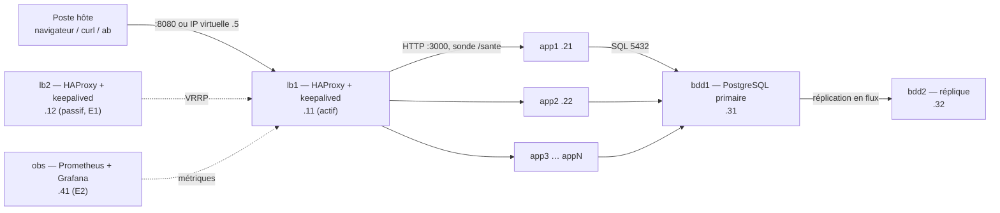

# Dossier d'architecture — Plateforme RÉSULTATS-BF

Master 2 Informatique — Module DevOps et infrastructures reproductibles
Groupe n° 8

> **À lire avant de rendre** : ce document est un **brouillon structuré**. Les sections 1 à 6 décrivent
> l'architecture livrée dans le dépôt. La section 7 (résultats) doit être remplie **uniquement avec vos mesures réelles**
> (`tests/resultats/`). Adaptez, corrigez et reformulez : chaque membre doit pouvoir défendre chaque phrase.

---

## 1. Contexte et objectifs

Chaque année, la publication des résultats d'examens fait tomber le site dans les minutes qui suivent l'annonce :
l'infrastructure n'a été conçue ni pour absorber un pic de consultations, ni pour survivre à la panne d'une machine.
Notre mission est de construire la plateforme RÉSULTATS-BF, qui permet à un candidat de consulter son résultat à partir de
son matricule, avec deux exigences non fonctionnelles prioritaires :

- **Résilience** : la panne d'une machine ne doit pas interrompre le service.
- **Scalabilité** : absorber plus de trafic se fait en ajoutant des machines, sans réécrire la configuration.

S'y ajoute une contrainte transversale : **toute l'infrastructure est décrite en code** et se reconstruit sur n'importe quel
poste, sans geste manuel (`vagrant destroy -f` puis `vagrant up`). Le cadre est imposé : Vagrant + VirtualBox, box
`bento/ubuntu-24.04` à version épinglée, socle de 5 machines tenant dans 3 Go de RAM, aucune ressource payante.

## 2. De l'exigence au choix d'architecture

| Exigence                       | Choix d'architecture                                                                      | Justification                                                                                              |
| ------------------------------ | ----------------------------------------------------------------------------------------- | ---------------------------------------------------------------------------------------------------------- |
| Résilience applicative         | N ≥ 2 serveurs applicatifs derrière un répartiteur HAProxy avec sonde `/sante`            | Un serveur défaillant est écarté automatiquement en quelques secondes ; le trafic continue vers les autres |
| Résilience des données         | Réplique PostgreSQL en flux (bdd2) + procédure de bascule scriptée                        | Une copie à jour de la base existe en permanence et peut être promue                                       |
| Résilience du répartiteur (E1) | lb2 + keepalived, IP virtuelle VRRP                                                       | Supprime le point de défaillance unique du répartiteur                                                     |
| Scalabilité                    | Applications **sans état**, `NB_APP` paramétrable, configuration du répartiteur engendrée | Ajouter un serveur = changer une valeur ; le retirer est indolore car aucun état n'y vit                   |
| Reproductibilité               | Vagrantfile + scripts idempotents, `.env.exemple`, `noeuds.yml` engendré                  | Une infrastructure qui ne se reconstruit pas est un objet fragile que personne n'ose toucher               |
| Observabilité (E2)             | Prometheus + node_exporter + Grafana                                                      | « Mesurer plutôt qu'affirmer » : débit et pannes visibles sur un tableau de bord                           |

## 3. Architecture

_(Remplacez ou complétez ce schéma par l'image produite par l'architecte : plan d'adressage, ports et flux.)_

### 3.1 Inventaire des machines (X = 55 + numéro de groupe)

| Machine     | Rôle                                   | Adresse            | RAM    | Statut       |
| ----------- | -------------------------------------- | ------------------ | ------ | ------------ |
| bdd1        | PostgreSQL primaire (lecture/écriture) | 192.168.X.31       | 768 Mo | Obligatoire  |
| bdd2        | Réplique en flux, promouvable          | 192.168.X.32       | 768 Mo | Obligatoire  |
| app1 … appN | Serveurs applicatifs sans état (N ≥ 2) | 192.168.X.21 … .2N | 512 Mo | Obligatoire  |
| lb1         | Répartiteur actif (HAProxy)            | 192.168.X.11       | 512 Mo | Obligatoire  |
| lb2         | Répartiteur passif (keepalived)        | 192.168.X.12       | 512 Mo | Extension E1 |
| obs         | Supervision                            | 192.168.X.41       | 768 Mo | Extension E2 |
| (virtuelle) | IP virtuelle VRRP                      | 192.168.X.5        | —      | Extension E1 |

Socle : 5 VM, 3 072 Mo. Avec E1 + E2 : 4 352 Mo (extensions déployées une par une pendant le développement).

### 3.2 Flux et cloisonnement réseau (R8)

Tout le trafic interne circule sur le réseau privé hôte-seul `192.168.X.0/24`, plage autorisée par défaut par VirtualBox
(aucune modification de `/etc/vbox/networks.conf`, ce qui préserve la reproductibilité). Seul `lb1` redirige un port vers
l'hôte (80 → 8080). Les pages d'administration (stats HAProxy :8404, métriques :8405, Prometheus :9090, Grafana :3000)
ne sont accessibles que depuis le réseau privé.

## 4. Description des composants

#### 4.1 Vagrantfile et source unique de vérité (R1, R3)

Le `Vagrantfile` est la recette de toute la plateforme. Il ne contient aucune liste de machines écrite à la main : il
construit une table `NOEUDS` (nom, adresse, rôle, mémoire) à partir de quelques réglages, puis s'en sert pour deux
choses :

1. définir les machines virtuelles ;
2. écrire cette même table dans `config/noeuds.yml`, que tous les scripts de provisionnement relisent.

**Réglages.** Ils sont lus dans `.env` (copié depuis `.env.exemple` au premier lancement). Une variable exportée dans le
terminal l'emporte sur `.env`.

| Réglage     | Valeur admise | Effet                                                              |
| ----------- | ------------- | ------------------------------------------------------------------ |
| `GROUPE`    | 1 à 8         | Réseau privé `192.168.(55 + GROUPE).0/24` ; notre groupe : 8 → `192.168.63.0/24` |
| `NB_APP`    | 2 à 9         | Nombre de serveurs applicatifs `app1` … `appN`                      |
| `PORT_HOTE` | un port libre | Port du poste hôte redirigé vers `lb1` (défaut 8080)                |
| `WITH_LB2`  | 0 ou 1        | 1 : ajoute `lb2` et l'IP virtuelle (extension E1)                   |
| `WITH_OBS`  | 0 ou 1        | 1 : ajoute `obs` (extension E2)                                     |

Le Vagrantfile s'arrête avec un message si `GROUPE` ou `NB_APP` sortent de leur intervalle.

**Table des machines.** `bdd1` (`.31`, rôle `bdd`) et `bdd2` (`.32`, rôle `replique`) sont toujours présentes, ainsi que
`lb1` (`.11`). Les serveurs applicatifs reçoivent les adresses `.21`, `.22`, … ; `lb2` (`.12`) et `obs` (`.41`)
n'apparaissent que si leur drapeau est à 1. Le rôle d'une machine désigne le script exécuté à son démarrage :
`scripts/<rôle>.sh`.

**Fichier engendré.** `config/noeuds.yml` contient le groupe, le réseau, l'IP virtuelle (`.5`), l'indicateur `avec_lb2` et
la liste des machines. Il n'est réécrit que si son contenu change. Les scripts y lisent les adresses grâce aux fonctions
de `scripts/common.sh` (`ip_de`, `noeuds_par_role`). La configuration de HAProxy et les cibles de Prometheus sont ainsi
**engendrées** depuis la même table : aucune adresse de serveur applicatif n'est écrite en dur dans ces fichiers.

Passer de 2 à 4 serveurs applicatifs : `NB_APP=4 vagrant up`. Le provisionnement de `lb1` est déclaré `run: 'always'` ;
il est donc rejoué à chaque `vagrant up` et le répartiteur suit `NB_APP`. Les autres machines ne sont provisionnées
qu'une fois.

**Autres choix.**

- Image de base `bento/ubuntu-24.04`, version `202404.26.0` figée, sans recherche de mise à jour (`box_check_update =
  false`) : tous les membres obtiennent la même image.
- Chaque machine a 1 processeur et une mémoire propre à son rôle (512 ou 768 Mo) ; les disques sont des clones liés
  (`linked_clone`), plus rapides à créer.
- Les mots de passe ne sont jamais écrits dans le dépôt : le Vagrantfile les lit dans `.env` et les transmet aux scripts
  par variables d'environnement (voir 4.5).
- Seule `lb1` ouvre un port vers le poste hôte (`127.0.0.1:PORT_HOTE` vers le port 80). Les autres machines ne sont
  joignables que sur le réseau privé (voir 3.2).

### 4.2 Application (sans état)

Service HTTP en Python (< 100 lignes), trois points d'entrée :

| Route                       | Comportement                                                               |
| --------------------------- | -------------------------------------------------------------------------- |
| `GET /resultat?matricule=…` | Résultat JSON lu dans la base ; 400 si le paramètre manque, 404 si inconnu |
| `GET /sante`                | 200 si `SELECT 1` réussit, 503 sinon — jamais 200 « par principe »         |
| `GET /info`                 | Nom d'hôte du serveur qui répond (observer la répartition)                 |

L'application ne conserve ni session, ni fichier local, ni compteur : tout l'état vit dans PostgreSQL. Elle démarre même si
la base est absente (connexion créée à la demande) et répond alors 503 proprement. Les connexions ont des délais bornés
(`connect_timeout`, `tcp_user_timeout`, keepalives TCP) pour détecter vite une base injoignable. Le compte applicatif n'a
qu'un droit de lecture sur la table.

### 4.3 Répartiteur HAProxy et sonde de santé (R4)

Algorithme `roundrobin`. La sonde `GET /sante` est exécutée toutes les secondes (`inter 1s`) ; un serveur est écarté après
2 échecs (`fall 2`) et réintégré après 2 succès (`rise 2`), soit un délai de détection de l'ordre de 2 à 3 secondes, inférieur
au seuil de 5 s. `option redispatch` et `retries 2` rejouent sur un autre serveur une requête dont la connexion a échoué.

### 4.4 PostgreSQL et réplication (R5, R6)

- **bdd1** : création idempotente du rôle applicatif, du rôle `replicator`, de la base et de la table `resultats`
  (`matricule`, `nom`, `serie`, `moyenne`, `admis`), peuplée de **50 000 lignes** par `generate_series`, avec des valeurs
  déterministes pour que les mesures soient comparables après chaque reconstruction.
- **bdd2** : copie initiale par `pg_basebackup -R` (réplication en flux, `standby.signal`). Un fichier marqueur empêche
  de ré-écraser bdd2 par une copie de bdd1 après une promotion.
- Le répertoire de données reste dans `/var/lib/postgresql` (jamais dans un dossier synchronisé).
- `max_connections` est identique sur primaire et réplique (condition de démarrage d'un standby).

**Bascule** (`scripts/bascule.sh`, depuis l'hôte) : (1) vérification que bdd2 est bien une réplique, (2) arrêt de bdd1 si elle tourne encore, (3) promotion de bdd2 par `SELECT pg_promote(true, 60)` et pose d'un fichier marqueur, (4) repointage de `DB_HOST` sur chaque serveur applicatif (adresses lues dans `config/noeuds.yml`) et redémarrage du service. Le script affiche sa durée. Il n'y a pas de bascule retour automatique.

### 4.5 Secrets (R7)

Les mots de passe vivent dans `.env` (ignoré par Git) ; `.env.exemple` est versionné avec des valeurs factices. Le
Vagrantfile les transmet aux scripts par variables d'environnement.

### 4.6 Idempotence (R2)

Les fichiers de configuration ne sont réécrits — et les services redémarrés — que si leur contenu change (fonction
`ecrire_fichier`). Rôles et base ne sont créés que s'ils n'existent pas. Aucun `>>`. Les installations `apt` sont groupées.

### 4.7 Extension E1 — répartiteur redondant

lb2 reçoit la même configuration HAProxy. `keepalived` partage l'IP virtuelle `192.168.X.5` entre lb1 (MASTER, priorité 100)
et lb2 (BACKUP, priorité 90) en VRRP **unicast** (plus fiable que le multicast sur un réseau hôte-seul VirtualBox). Un script
de vérification fait céder l'IP si HAProxy s'arrête. Les clients utilisent l'IP virtuelle, qui ne change pas à la bascule.

### 4.8 Extension E2 — observabilité

`node_exporter` tourne sur chaque VM ; HAProxy expose ses métriques (`:8405/metrics`). Prometheus collecte toutes les 5 s
les cibles engendrées depuis `noeuds.yml`. Un tableau de bord Grafana, provisionné par fichier, affiche : le débit au
répartiteur, le nombre de serveurs applicatifs actifs, les machines joignables et l'utilisation CPU.

## 5. Points de défaillance uniques

| Composant          | Risque                       | Traitement            | Reste-t-il un risque ?                                                                                    |
| ------------------ | ---------------------------- | --------------------- | --------------------------------------------------------------------------------------------------------- |
| Serveur applicatif | Panne d'un serveur           | N ≥ 2, sonde `/sante` | Non tant qu'il reste un serveur sain                                                                      |
| Répartiteur        | Panne de lb1                 | E1 : lb2 + VRRP       | Non avec E1 ; **oui** sans E1                                                                             |
| Base primaire      | Panne de bdd1                | Réplique + bascule    | **Oui** : bascule déclenchée à la main, pertes possibles des dernières écritures (réplication asynchrone) |
| Réplique           | Panne de bdd2                | —                     | Perte de la redondance uniquement                                                                         |
| Supervision        | Panne de obs                 | —                     | Perte de la visibilité, pas du service                                                                    |
| Poste hôte         | Panne de la machine physique | —                     | **Oui** : toutes les VM partagent un seul poste (limite de l'exercice)                                    |

## 6. Procédures d'exploitation

**Ajouter des serveurs applicatifs.** Mettre `NB_APP=4` dans `.env`, puis `vagrant up`. Les nouvelles VM sont créées et lb1
(provisionné à chaque `up`) régénère sa configuration. Vérifier avec `tests/v1_repartition.sh`.

**Retirer un serveur.** `vagrant destroy -f app4`, puis `NB_APP=3` dans `.env` et `vagrant provision lb1`.

**Basculer la base.** `./scripts/bascule.sh`. Après la bascule, ne pas lancer `vagrant provision` sur les apps (cela les
repointerait sur bdd1). Pour réintégrer l'ancien primaire, le reconstruire comme réplique de bdd2 (voir limites).

**Reconstruire.** `vagrant destroy -f && vagrant up` (rejouable sur n'importe quel poste).

**Activer une extension.** Mettre `WITH_LB2=1` ou `WITH_OBS=1` dans `.env`, puis `vagrant up` (E2 : puis
`vagrant provision` pour installer node_exporter sur les VM existantes).

## 7. Résultats des scénarios de validation

> Pour chaque scénario : commande exacte, résultat brut (fichier de `tests/resultats/`), commentaire honnête.
> **Remplissez ces tableaux avec vos chiffres.** Ne laissez aucune valeur par défaut.

**Conditions de mesure** : poste …, CPU …, RAM …, VirtualBox …, `NB_APP` …, extensions …

### V1 — Répartition

| Commande                        | `./tests/v1_repartition.sh` |
| ------------------------------- | --------------------------- |
| Fichier source                  |                             |
| Appels par serveur              | app1 : … / app2 : …         |
| Écart max-min (objectif < 20 %) | … %                         |
| Commentaire                     |                             |

### V2 — Panne d'un serveur applicatif

| Commande                    | `./tests/v2_panne_app.sh` (`vagrant halt app1` pendant 50 s de charge) |
| --------------------------- | ---------------------------------------------------------------------- |
| Fichier source              |                                                                        |
| Requêtes envoyées / perdues | … / …                                                                  |
| Période dégradée            | … s (objectif : plus aucune erreur au-delà de 5 s)                     |
| Commentaire                 |                                                                        |

### V3 — Montée en charge

| Configuration | Commande                        | Requêtes/s | Requêtes en échec | Fichier source |
| ------------- | ------------------------------- | ---------- | ----------------- | -------------- |
| N = 2         | `./tests/v3_charge.sh`          | …          | …                 |                |
| N = 4         | `NB_APP=4 vagrant up` puis idem | …          | …                 |                |

Commentaire — **à rédiger d'après vos chiffres**. Éléments à discuter : les 4 à 6 VM se partagent le processeur d'un seul
ordinateur (chaque VM a 1 vCPU), donc doubler les serveurs applicatifs ne double pas le débit et il peut même baisser ;
le goulot peut être la base ou HAProxy plutôt que les applications ; ce n'est pas un échec mais un résultat.

### V4 — Panne de la base primaire

| Commande                              | `./tests/v4_panne_bdd.sh` |
| ------------------------------------- | ------------------------- |
| Fichier source                        |                           |
| Délai avant `/sante` = 503            | … s                       |
| Comportement observé pendant la panne | 503 propre / autre : …    |
| Durée de la bascule (`bascule.sh`)    | … s                       |
| Durée totale depuis l'arrêt de bdd1   | … s                       |
| Commentaire                           |                           |

### V5 — Reconstruction

| Commande                           | `./tests/v5_reconstruction.sh` |
| ---------------------------------- | ------------------------------ |
| Fichier source                     |                                |
| Durée totale                       | … min … s                      |
| Intervention manuelle nécessaire ? | non / oui : …                  |

### V6 — Panne du répartiteur (E1)

| Commande                            | `./tests/v6_panne_lb.sh` (`vagrant halt lb1`, charge sur l'IP virtuelle) |
| ----------------------------------- | ------------------------------------------------------------------------ |
| Fichier source                      |                                                                          |
| Temps de reprise après bascule VRRP | … s (objectif < 5 s)                                                     |
| Requêtes perdues                    | …                                                                        |
| Commentaire                         |                                                                          |

### Tableau de bord (E2)

Joindre deux captures Grafana : (1) le débit qui monte pendant la charge V3 ; (2) un serveur actif qui disparaît pendant V2.

## 8. Limites connues

- **Un seul poste physique** : les VM se disputent le CPU ; les mesures de débit ne sont pas extrapolables à de vrais serveurs.
- **Bascule manuelle** de la base : pas d'élection automatique (type Patroni) ; réplication asynchrone, donc perte possible des
  dernières écritures au moment de la panne.
- **Réintégration de l'ancien primaire** non automatisée : bdd1 doit être reconstruit comme réplique de bdd2.
- **`vagrant provision` après une bascule** remet les applications sur bdd1 (état déclaré).
- **Pas de TLS** entre les composants, ni de pare-feu hôte (réseau privé de laboratoire).
- Mots de passe transmis par variables d'environnement, visibles dans la VM (fichier à droits restreints) : acceptable ici,
  à remplacer par un coffre-fort de secrets en production.
- Résultat statique : la table `resultats` est en lecture seule pour l'application.
- **Service applicatif** : au plus 30 requêtes simultanées vers la base, les suivantes attendent ; aucun cache, chaque demande interroge la base.
- _(Ajoutez ici les limites réellement rencontrées pendant vos essais.)_

## 9. Ce que nous ferions autrement

- Automatiser la bascule (détection de panne + promotion) avec un outil dédié et ajouter un témoin (quorum) contre le
  « split-brain ».
- Mettre un cache (E3) devant la base pour les consultations répétées et discuter l'invalidation.
- Déploiement sans coupure (E4) : sortir un serveur de HAProxy, le mettre à jour, le réintégrer, serveur par serveur.
- Tests automatisés en intégration continue (reconstruction hebdomadaire).
- _(Complétez avec votre retour d'expérience.)_

## 10. Reproduire la plateforme

Voir le `README.md` du dépôt : `git clone`, `cp .env.exemple .env`, `vagrant up`.

## Annexe — Organisation de l'équipe

| Membre              | Rôle                              | Périmètre                                                     |
| ------------------- | --------------------------------- | ------------------------------------------------------------- |
| BASSOLÉ René Junior | Architecte réseau et répartition  | Plan d'adressage, Vagrantfile, HAProxy, sonde, E1, E2         |
| BELEM               | Ingénieur applicatif              | Service HTTP, absence d'état, gestion des erreurs de base, E4 |
| YARO Laurentine     | Ingénieur données                 | PostgreSQL, jeu de données, réplication, bascule, E3          |
| ZONGO Roukia        | Ingénieur essais et observabilité | Scénarios V1–V6, mesures, rédaction des résultats             |
