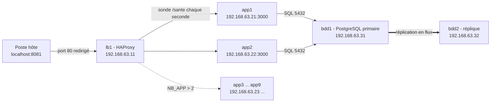
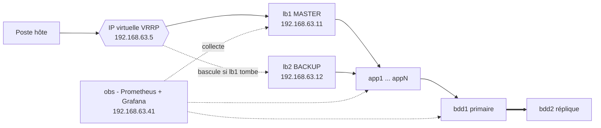

# Schéma d'architecture et plan d'adressage

Projet RÉSULTATS-BF, groupe 8, réseau privé `192.168.63.0/24` (X = 55 + 8 = 63).
Ce fichier se lit directement sur GitHub (le schéma Mermaid s'affiche tout seul).

## Schéma du socle

## Schéma avec les extensions

## Inventaire des machines

| Machine | Rôle | Adresse | RAM | Statut |
|---|---|---|---|---|
| lb1 | Répartiteur de charge HAProxy | 192.168.63.11 | 512 Mo | Socle |
| app1 | Serveur applicatif sans état | 192.168.63.21 | 512 Mo | Socle |
| app2 | Serveur applicatif sans état | 192.168.63.22 | 512 Mo | Socle |
| app3 ... app9 | Serveurs applicatifs supplémentaires (`NB_APP`) | 192.168.63.23 ... .29 | 512 Mo chacun | Passage à l'échelle |
| bdd1 | PostgreSQL primaire | 192.168.63.31 | 768 Mo | Socle |
| bdd2 | PostgreSQL réplique en flux | 192.168.63.32 | 768 Mo | Socle |
| lb2 | Répartiteur passif | 192.168.63.12 | 512 Mo | Extension E1 |
| (VIP) | IP virtuelle VRRP | 192.168.63.5 | - | Extension E1 |
| obs | Prometheus et Grafana | 192.168.63.41 | 768 Mo | Extension E2 |

**RAM du socle** : 768 + 768 + 512 + 512 + 512 = **3 072 Mo** (3 Go).
Avec `NB_APP=4` : 4 096 Mo. Avec E1 : + 512 Mo. Avec E2 : + 768 Mo (activer les extensions **une par une** sur un poste de 8 Go).

## Plan d'adressage

| Plage | Usage |
|---|---|
| `192.168.63.1x` | Répartiteurs (lb1 = .11, lb2 = .12) |
| `192.168.63.5` | IP virtuelle (E1) |
| `192.168.63.2x` | Serveurs applicatifs (appN = .(20 + N)) |
| `192.168.63.3x` | Bases de données (bdd1 = .31, bdd2 = .32) |
| `192.168.63.41` | Supervision (E2) |

La plage `192.168.56.0/21` est la plage hôte uniquement (host-only) autorisée par défaut par VirtualBox 6.1.28 et plus :
le sous-réseau du groupe 8 (`192.168.63.0/24`) en fait partie, **sans modifier `/etc/vbox/networks.conf`**.

## Ports et flux

| Flux | Port | Remarque |
|---|---|---|
| Poste hôte vers lb1 | 80 (hôte : 8081 via `PORT_HOTE`) | **Seul port redirigé vers l'hôte** (R8) |
| lb1 vers appN | 3000 | Sonde `GET /sante` chaque seconde (`inter 1s fall 2 rise 2`) |
| appN vers bdd1 | 5432 | Rôle applicatif, `scram-sha-256` |
| bdd2 vers bdd1 | 5432 | Rôle `replicator`, réplication en flux |
| lb vers Prometheus (E2) | 8405 | Métriques HAProxy, réseau privé uniquement |
| Page de statistiques HAProxy | 8404 | Réseau privé uniquement, non redirigé |
| Grafana (E2) | 3000 sur obs | Réseau privé uniquement |

## Principe de reproductibilité

Le Vagrantfile engendre `config/noeuds.yml` à partir de la table `NOEUDS`. La configuration de HAProxy, de keepalived
et de Prometheus en est **dérivée** : aucune adresse d'application n'est écrite en dur. Changer `NB_APP` dans `.env`
suffit à ajouter des serveurs.